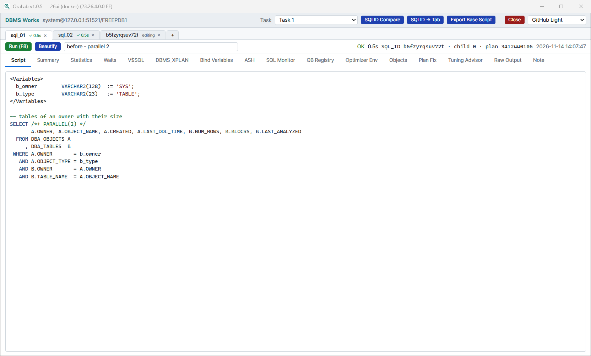
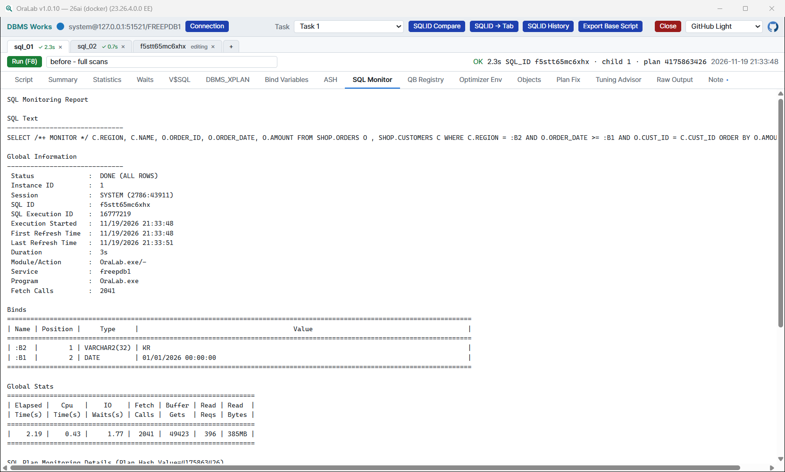
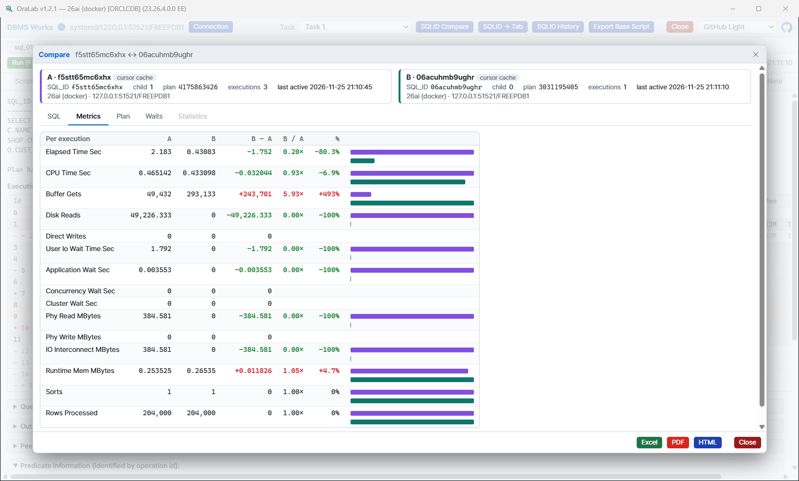
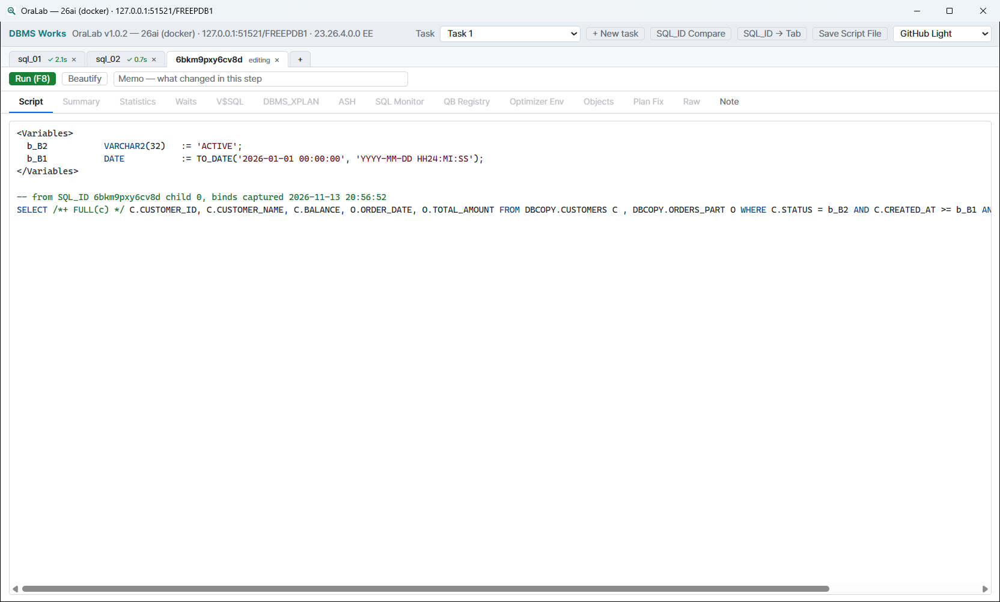
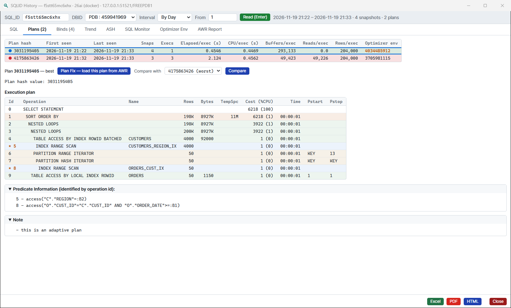
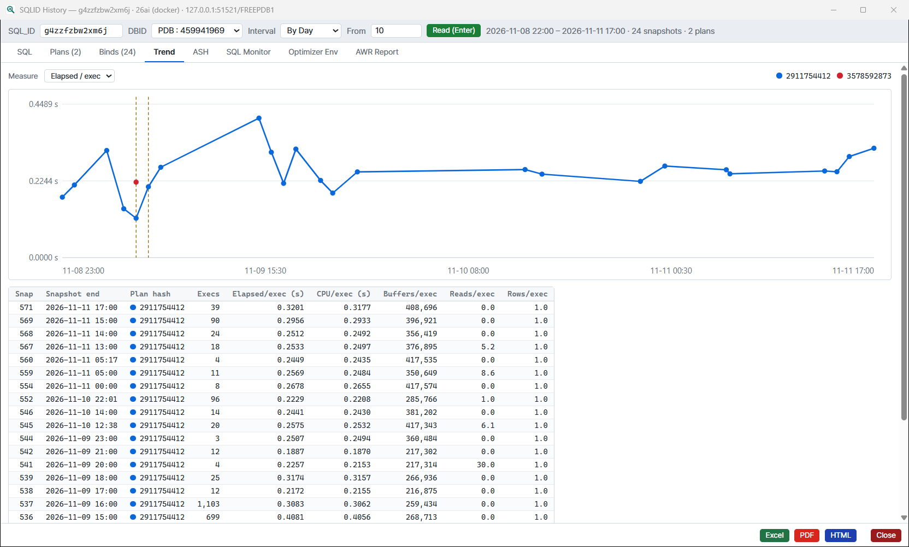

# OraLab — Oracle SQL 튜닝 작업대 (무료)


**[최신 릴리스 받기](https://github.com/Doni-Kim/oralab-release/releases/latest)** ·
[English](README.md) · [사용 설명서 (한국어)](OraLab_manual_kr.html) · [User guide (English)](OraLab_manual_en.html)

OraLab 은 SQL 하나를 붙들고 튜닝하는 데스크톱 작업대입니다. SQL 을 붙여 넣고 F8 을 누르면 세션 통계 · 대기 이벤트 ·
V$SQL 수치 · 실제 실행 계획을 한 번에 받습니다. SQL 을 고쳐 다음 탭에서 다시 돌리고, 두 실행을 나란히 견줍니다.
창 하나, 실행 파일 하나 — 서버에 설치할 것이 없고 PC 에 Oracle 클라이언트도 필요 없습니다.

## 화면

| SQL 과 바인드 변수가 든 탭 | 실행 요약 |
|---|---|
|  |  |

| 세션 통계 (V$MYSTAT 델타) | 실제로 실행된 계획 |
|---|---|
|  |  |

| Bind Variables — SQL_ID 의 바인드 값 묶음 | 병렬 실행의 SQL Monitor 리포트 |
|---|---|
|  |  |

| Objects — 테이블 · 인덱스 · 조건 컬럼 | Plan Fix — SQL Patch · baseline · SQL Profile 스크립트 |
|---|---|
|  |  |

| Tuning Advisor — 고칠 수 있는 스크립트와 리포트 | 비교 — 실행 1회당 수치 |
|---|---|
|  |  |

| 비교 — 두 계획을 한 테이블로 | SQLID Compare — 커서 캐시 · AWR 의 SQL_ID 둘 |
|---|---|
|  |  |

| SQLID → Tab, 캡처된 바인드 값과 함께 | Task 목록 |
|---|---|
|  |  |

| SQLID History — AWR 에 남은 SQL_ID 의 계획들 | SQLID History — 추이, 선 색 = 계획 |
|---|---|
|  |  |

그림은 로컬 시험 DB 의 시험용 테이블입니다.

## 설치

- 압축을 풀고 폴더째 두고 `OraLab.exe` 를 실행합니다(단일 파일).
- .NET 설치도 Oracle 클라이언트도 필요 없습니다 — 실행 파일 안에 들어 있습니다.
- 설정 파일이 없습니다. 접속은 시작 창에서 넣고, 나머지 전부와 함께 실행 파일 옆의 `OraLab.db` 에 저장됩니다(비밀번호는 암호화).

## 하는 일

- **SQL 을 끝까지 돌리고, 서버에서 잰다** — SQL 을 Trace 스크립트에 끼워 모든 행을 가져오며 실행하고, 세션 통계 델타(V$MYSTAT,
  PX 슬레이브 포함) · 대기 이벤트 · V$SQL 수치 · 실제 행 수와 시간 · 버퍼가 든 `DBMS_XPLAN.DISPLAY_CURSOR` 를 받습니다.
  구간마다 정렬되는 테이블로 보입니다. 실행은 ROLLBACK 으로 끝납니다.
- **바인드 변수** — 탭 맨 앞의 `<Variables>` 블록에 선언하면 SQL 이 그 변수를 진짜 바인드로 씁니다. 바인드 피킹 · 커서 공유가 운영과 같습니다.
- **세션 명령** — `<Commands>` 블록(`ALTER SESSION …`, PL/SQL 블록)을 SQL 앞에 두면 테스트 SQL 전에, 뒤에 두면 측정이 끝난 뒤에 같은 세션에서 돌고, 결과에 같이 남습니다.
- **단계를 탭으로** — 고칠 때마다 탭 하나, 탭마다 메모와 노트. 탭은 Task 로 묶입니다. 스크립트 · 노트 · 결과는 저절로 저장됩니다.
- **비교** — 탭 둘, 또는 커서 캐시 · AWR 의 SQL_ID 둘: 실행 1회당 수치, 두 계획을 한 테이블로 합쳐 줄고 는 것 표시, 대기, 통계.
  엑셀(차트 포함) · PDF · HTML 로 저장합니다.
- **SQLID → Tab** — 커서 캐시(또는 AWR)의 SQL 을 바인드 값과 함께 탭으로 가져옵니다. 값은 가장 오래 걸린 SQL Monitor 실행 →
  커서 캐시의 캡처 → AWR 순으로 찾습니다.
- **Bind Variables** — SQL_ID 의 바인드 값 묶음(SQL Monitor 실행 · 커서 캐시 · AWR)을 콤보로 골라 보고, 변수 선언 또는 리터럴로 새 탭에 엽니다.
- **SQLID History** — SQL_ID 하나가 AWR 에 남긴 것을 따로 뜨는 창에서: 계획마다 1회당 성적(가장 좋은 · 나쁜 것 표시), 스냅샷마다 바인드 값,
  계획이 바뀐 곳이 보이는 추이, ASH, 지난 SQL Monitor 리포트, 옵티마이저 환경, AWR SQL 리포트 — 그리고 그 전부의 엑셀 · PDF · HTML.
  Plan Fix 는 AWR 의 계획을 baseline 으로 싣는 글을 보여 줍니다.
- **Objects** — 실행된 계획의 테이블, 그 인덱스 전부(계획이 쓴 것에 표시), 조건 컬럼의 통계: NDV · 히스토그램 · Low/High ·
  압축 · In-Memory · 파티션.
- **Plan Fix** — 탭의 계획을 SQL Patch · SQL Plan Baseline · SQL Profile(리터럴만 다른 문장에도 적용)로 고정하는 스크립트.
  보여 주기만 하고 실행하지 않습니다.
- **Tuning Advisor** — 탭이 실행한 커서로 SQL Tuning Advisor 를 돌리고 리포트를 탭에 남깁니다(Tuning Pack).
- **Connection** — 다시 시작하지 않고 다른 서버로 바꿉니다. Task · 탭은 그대로입니다. 서버에 닿지 못하면 주소 앞의 점이 빨강이 됩니다.
- **그 밖에** — 계획 줄별 ASH, SQL Monitor 리포트, Query Block Registry, 옵티마이저 환경, 계획 줄 색, Beautify(공백 · 줄바꿈만),
  SQL*Plus 식 스크립트 통째 실행, 탭 하나의 엑셀 · PDF · HTML, 테마 12종.
- **Exadata** 에서는 통계에 Smart Scan · Storage Index · HCC · Flash Cache 항목과 짧은 판정이 더해집니다.
- **시퀀스 캐시 채우기 시간**(1.0.8) — 통계의 34번 줄에 SQL 이 시퀀스 캐시를 채우는 데 쓴 시간이 나옵니다.
  1 ms 이상일 때만 보이며, 보이면 캐시가 작거나 `NOCACHE` 라는 신호입니다.

자세한 것은 같이 들어 있는 사용 설명서(그림 포함, 한국어 · 영어)에 있습니다.

## Diagnostics · Tuning Pack

팩 라이선스가 필요한 기능은 **기본으로 꺼져 있습니다.** 접속마다 체크 상자가 둘 있고, 체크하지 않은 팩의 것은 OraLab 이 읽지 않습니다 —
그 뷰를 조회하는 것만으로 `DBA_FEATURE_USAGE_STATISTICS` 에 흔적이 남기 때문입니다.

- **Diagnostics Pack licensed** — 탭 실행의 계획 줄별 ASH, SQLID Compare 의 AWR 과 ASH 대기, SQLID → Tab 의 AWR 바인드 값, SQLID History.
- **Tuning Pack licensed** — 탭 실행의 SQL Monitor 리포트, SQLID → Tab 의 SQL Monitor 바인드 값, Plan Fix 의 SQL Profile 절, Tuning Advisor 서브탭, SQLID History 의 SQL Monitor 탭.

체크했더라도 서버의 `control_management_pack_access` 가 그 팩을 막아 두었으면 읽지 않습니다. 예외 하나: Trace 스크립트를 통째로 붙여 넣은
탭은 사용자의 글이라 적힌 그대로 실행됩니다 — 거기서는 스크립트에서 두 구간을 직접 끄십시오(사용 설명서 13장).

## 요구 사항과 한계

- **Windows 전용**(x64). 화면이 웹 기술(Blazor Hybrid)이라 Linux · macOS 에서는 돌지 않습니다.
- **Oracle 12.2 이상.** 12.2 · 19c · 26ai 에서 확인했습니다.
- 문장 하나만 든 탭은 SELECT · WITH 만 받습니다. DML · DDL · PL/SQL 은 스크립트로 돌립니다.
- 코드는 ConfuserEx 로 난독화했습니다 — 무료 도구라 강한 보호를 기대하지는 마십시오.

## 권한

아래 권한이면 OraLab 의 모든 기능이 동작합니다 — 12.2 · 19c · 26ai 에서 이 권한만 가진 계정으로 확인했습니다.
*Export Base Script* 로 내보낸 스크립트 머리말에도 같은 grant 가 들어 있습니다.

```sql
CREATE USER oralab IDENTIFIED BY "...";
GRANT CREATE SESSION TO oralab;
GRANT SELECT_CATALOG_ROLE TO oralab;
GRANT SELECT ANY DICTIONARY TO oralab;
GRANT SELECT ANY TABLE TO oralab;                          -- 튜닝할 SQL 이 읽는 테이블 · 뷰
GRANT ADVISOR TO oralab;                                   -- Tuning Advisor 서브탭 (Tuning Pack)
GRANT EXECUTE ON SYS.DBMS_WORKLOAD_REPOSITORY TO oralab;   -- SQLID History 의 AWR Report (Diagnostics Pack)
-- 튜닝할 SQL 이 다른 스키마의 객체를 쓸 때만:
GRANT SELECT ANY SEQUENCE TO oralab;                       -- 시퀀스
GRANT EXECUTE ANY PROCEDURE TO oralab;                     -- 함수
```

DBMS_XPLAN · DBMS_SQLTUNE 등 나머지 패키지는 기본으로 PUBLIC 에 실행 권한이 있습니다. DBMS_WORKLOAD_REPOSITORY 는 없습니다.
Trace 스크립트는 PL/SQL 블록 하나라서, 읽는 뷰 가운데 하나라도 권한이 없으면 블록 전체가 컴파일 오류로 실행되지 않습니다.

## WebView2 런타임

OraLab 은 Microsoft Edge WebView2 런타임으로 창을 그립니다. 런타임이 없으면 시작할 때 알리고 끝납니다.
Windows 11 에는 들어 있고 Windows 10 에도 대부분 깔려 있습니다. Windows Server 는 따로 설치해야 하는 경우가 많습니다 —
Microsoft 의 "Evergreen Standalone Installer"(`MicrosoftEdgeWebView2RuntimeInstallerX64.exe`)를 받으십시오.
https://developer.microsoft.com/microsoft-edge/webview2/

## 문제가 생기면

오류는 실행 파일 옆의 `OraLab.log` 에 적힙니다(문제가 있었을 때만 생기는 파일).

- **버그 · 질문** — [이슈](https://github.com/Doni-Kim/oralab-release/issues)로 남겨 주세요.
  로그나 `OraLab.db` 는 올리지 마십시오. 로그에 비밀번호는 없지만, 둘 다 서버 주소와 SQL 이 들어 있을 수 있습니다.
