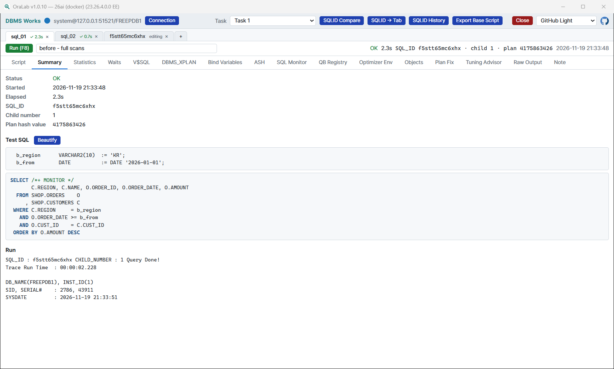
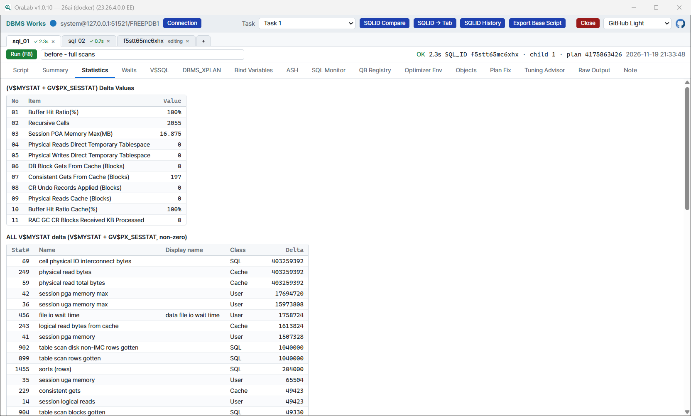
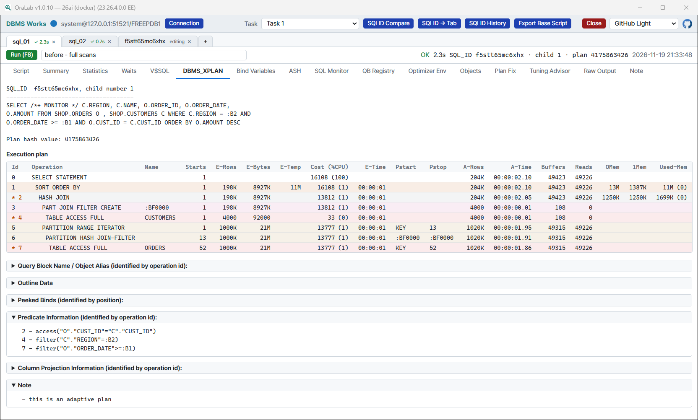
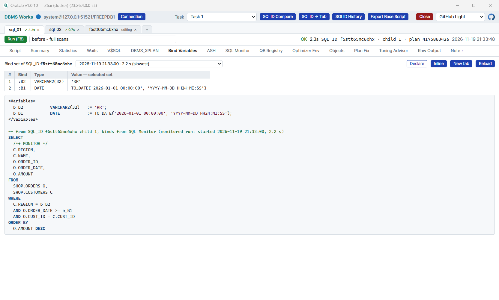
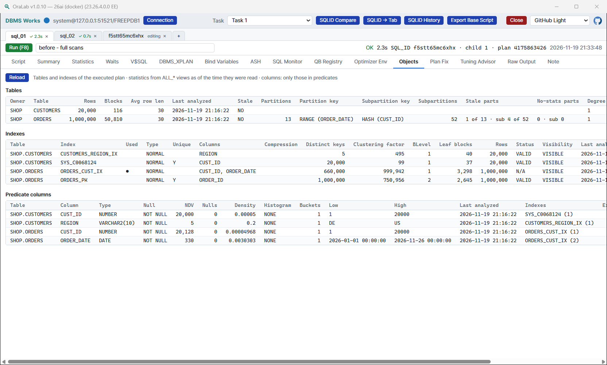
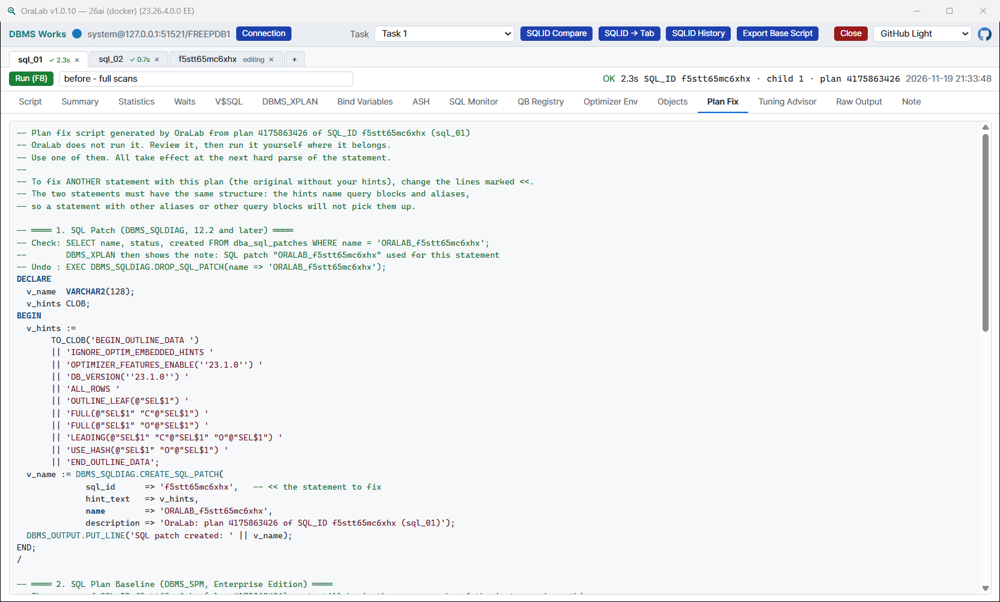
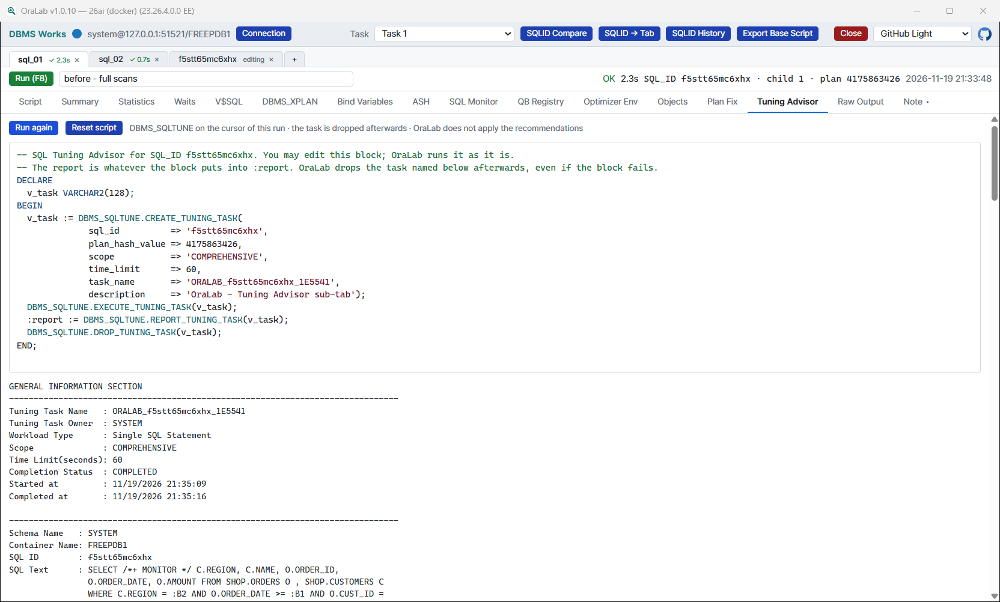
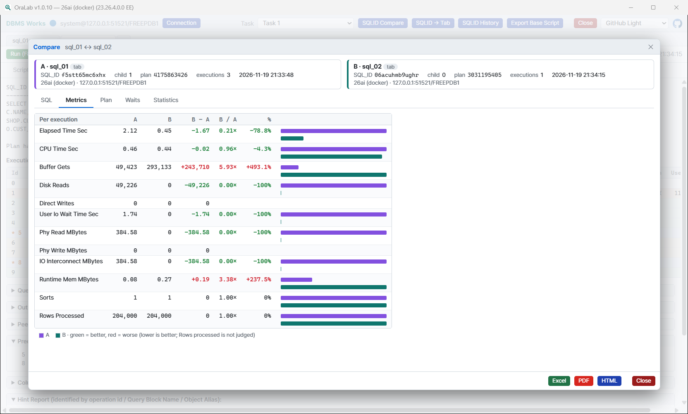
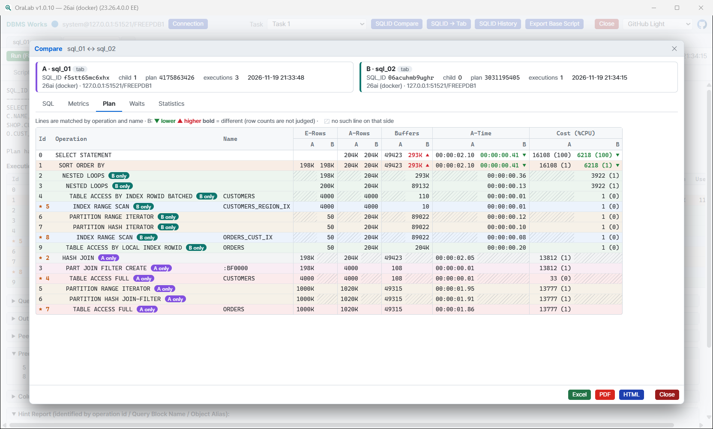
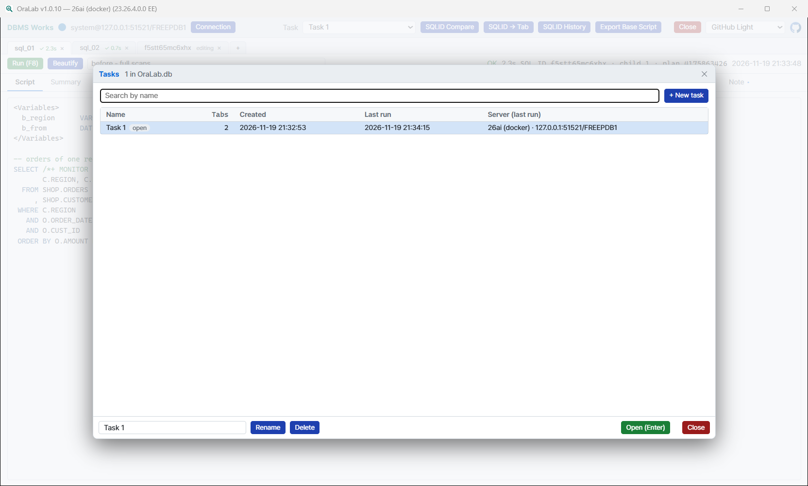

# OraLab — Oracle SQL 튜닝 작업대 (무료)


**[최신 릴리스 받기](https://github.com/Doni-Kim/oralab-release/releases/latest)** ·
[English](README.md) · [사용 설명서 (한국어)](OraLab_manual_kr.html) · [User guide (English)](OraLab_manual_en.html)

OraLab은 단일 SQL 튜닝에 집중하기 위해 설계된 경량 데스크톱 워크벤치입니다. SQL을 입력하고 F8 키만 누르면 세션 통계, 대기 이벤트, V$SQL 메트릭, 실제 실행 계획을 한 번에 확보할 수 있습니다. 튜닝한 쿼리를 새 탭에서 실행해 이전 실행 결과와 나란히 비교하며 개선 효과를 즉시 검증하세요. 단일 실행 파일 하나로 동작하며, DB 서버 측 설치나 로컬 Oracle 클라이언트 구성이 전혀 필요하지 않습니다.

## 화면

| SQL 과 바인드 변수가 든 탭 | 실행 요약 |
|---|---|
|  |  |

| 세션 통계 (V$MYSTAT 델타) | 실제로 실행된 계획 |
|---|---|
|  |  |

| Bind Variables — SQL_ID 의 바인드 값 묶음 | 병렬 실행의 SQL Monitor 리포트 |
|---|---|
|  |  |

| Objects — 테이블 · 인덱스 · 조건 컬럼 | Plan Fix — SQL Patch · baseline · SQL Profile 스크립트 |
|---|---|
|  |  |

| Tuning Advisor — 고칠 수 있는 스크립트와 리포트 | 비교 — 실행 1회당 수치 |
|---|---|
|  |  |

| 비교 — 두 계획을 한 테이블로 | SQLID Compare — 커서 캐시 · AWR 의 SQL_ID 둘 |
|---|---|
|  |  |

| SQLID → Tab, 캡처된 바인드 값과 함께 | Task 목록 |
|---|---|
|  |  |

| SQLID History — AWR 에 남은 SQL_ID 의 계획들 | SQLID History — 추이, 선 색 = 계획 |
|---|---|
|  |  |

그림은 로컬 시험 DB 의 시험용 테이블입니다.

## 설치

- 압축을 풀고 폴더째 두고 `OraLab.exe` 를 실행합니다(단일 파일).
- .NET 설치도 Oracle 클라이언트도 필요 없습니다 — 실행 파일 안에 들어 있습니다.
- 설정 파일이 없습니다. 접속은 시작 창에서 넣고, 나머지 전부와 함께 실행 파일 옆의 `OraLab.db` 에 저장됩니다(비밀번호는 암호화).

## 하는 일

- **SQL을 끝까지 돌리고, 서버에서 잰다** — SQL을 Trace 스크립트에 끼워 모든 행을 인출(Fetch)하며 실행하고, 세션 통계 델타(V$MYSTAT, PX 슬레이브 포함), 대기 이벤트, V$SQL 수치, 실제 행 수·시간·버퍼가 담긴 `DBMS_XPLAN.DISPLAY_CURSOR`를 수집합니다. 결과는 구간마다 정렬 가능한 테이블로 보이며, 실행은 항상 ROLLBACK으로 끝납니다.
- **바인드 변수** — 탭 맨 앞의 `<Variables>` 블록에 변수를 선언하면 SQL이 이를 실제 바인드로 사용합니다. 바인드 피킹과 커서 공유가 운영 환경과 동일하게 동작합니다.
- **세션 명령** — `<Commands>` 블록(`ALTER SESSION …`, PL/SQL 블록)을 SQL 앞에 두면 테스트 SQL 실행 전에, 뒤에 두면 측정이 끝난 직후에 같은 세션에서 실행되며 결과에도 함께 기록됩니다.
- **단계를 탭으로** — SQL을 고칠 때마다 탭을 하나씩 늘려가고, 탭마다 메모와 노트를 남깁니다. 연관된 탭들은 하나의 Task로 묶이며, 스크립트·노트·실행 결과는 모두 자동 저장됩니다.
- **비교** — 두 개의 탭, 또는 커서 캐시·AWR에 있는 두 SQL_ID를 맞대어 비교합니다. 실행 1회당 수치를 나란히 놓고, 두 실행 계획을 하나의 테이블로 합쳐 늘어나고 줄어든 부분, 대기 이벤트, 통계를 한눈에 표시합니다. 결과는 Excel(차트 포함)·PDF·HTML로 저장할 수 있습니다.
- **SQLID → Tab** — 커서 캐시나 AWR의 SQL을 바인드 값과 함께 탭으로 즉시 가져옵니다. 바인드 값은 가장 오래 걸린 SQL Monitor 실행 → 커서 캐시 캡처 → AWR 순으로 자동 탐색합니다.
- **Bind Variables** — 특정 SQL_ID에 기록된 바인드 값 묶음(SQL Monitor 실행·커서 캐시·AWR)을 콤보 박스로 골라 확인하고, 변수 선언 형태나 리터럴 치환 형태로 새 탭에 엽니다.
- **SQLID History** — SQL_ID 하나가 AWR에 남긴 전체 이력을 별도 창에서 추적합니다. 실행 계획별 1회당 성적(최고·최저 성능 표시), 스냅샷별 바인드 값, 계획이 바뀐 지점이 드러나는 추이 차트, ASH, 과거 SQL Monitor 리포트, 옵티마이저 환경, AWR SQL 리포트를 한곳에서 보며 전체를 Excel·PDF·HTML로 내보낼 수 있습니다. Plan Fix 기능은 AWR의 특정 계획을 Baseline으로 적재하는 스크립트를 생성해 줍니다.
- **Objects** — 실행된 계획에 등장하는 테이블과 그에 속한 모든 인덱스(계획이 실제 사용한 인덱스 표시), 그리고 조건절 컬럼의 통계(NDV, 히스토그램, Low/High, 압축, In-Memory, 파티션)를 한눈에 보여 줍니다.
- **Plan Fix** — 현재 탭의 실행 계획을 SQL Patch, SQL Plan Baseline, SQL Profile(리터럴만 다른 문장에도 적용 가능)로 고정하는 스크립트를 만들어 줍니다. 안전을 위해 스크립트를 보여 주기만 할 뿐 직접 실행하지는 않습니다.
- **Tuning Advisor** — 탭이 실행한 커서를 대상으로 SQL Tuning Advisor를 돌리고 리포트를 탭에 남깁니다(Tuning Pack 라이선스 필요).
- **Connection** — 프로그램을 재시작하지 않고 다른 DB 서버로 즉시 전환합니다. 기존 Task와 탭은 그대로 유지되며, 서버에 연결할 수 없으면 주소 앞의 상태 표시등이 빨간색으로 바뀝니다.
- **Exadata 지원** — Exadata 환경에서는 세션 통계에 Smart Scan, Storage Index, HCC, Flash Cache 항목과 함께 짧은 요약 판정이 자동으로 더해집니다.
- **시퀀스 캐시 채우기 시간** (1.0.8+) — 통계의 34번 줄에 SQL이 시퀀스 캐시를 채우는 데 소비한 시간이 표시됩니다. 1ms 이상일 때만 나타나며, 이 항목이 보인다면 시퀀스의 CACHE 크기가 너무 작거나 `NOCACHE`로 설정되어 있다는 신호입니다.
- **그 밖에** — 실행 계획 줄별 ASH 분포, SQL Monitor 리포트, Query Block Registry, 옵티마이저 환경 변수, 실행 계획 줄 색상 강조, SQL Beautify(공백·줄바꿈만 정리), 단일 탭 Excel·PDF·HTML 내보내기, UI 테마 12종을 지원합니다.

자세한 것은 같이 들어 있는 사용 설명서(그림 포함, 한국어 · 영어)에 있습니다.

## Diagnostics · Tuning Pack

오라클 옵션 팩 라이선스가 필요한 모든 기능은 보수적인 라이선스 관리를 위해 기본값이 비활성화되어 있습니다. 연결 프로필마다 두 개의 팩 허용 체크 상자가 제공되며, 선택하지 않은 팩과 연관된 딕셔너리 뷰는 OraLab이 일절 조회하지 않습니다. (단순 조회만으로도 `DBA_FEATURE_USAGE_STATISTICS`에 기능 사용 이력이 기록되기 때문입니다.)

- **Diagnostics Pack licensed**
  - 탭 실행: 실행 계획 줄별 ASH 분포
  - SQLID Compare: AWR 및 ASH 대기 이벤트 비교
  - SQLID → Tab: AWR 기반 바인드 값 추출
  - SQLID History: 전체 이력 조회
- **Tuning Pack licensed**
  - 탭 실행: SQL Monitor 리포트
  - SQLID → Tab: SQL Monitor 기반 바인드 값 추출
  - Plan Fix: SQL Profile 생성 절
  - Tuning Advisor: 서브탭 실행 및 리포트 조회
  - SQLID History: SQL Monitor 탭 조회

체크 상자를 활성화했더라도 대상 DB 서버의 `CONTROL_MANAGEMENT_PACK_ACCESS` 파라미터가 해당 팩을 제한하고 있다면 자동으로 조회를 건너뜁니다. 예외적으로 Trace 스크립트를 통째로 붙여 넣어 실행하는 탭은 사용자가 입력한 스크립트가 원본 그대로 실행되므로, 라이선스 미보유 환경에서는 스크립트 내의 관련 두 구간을 직접 주석 처리하거나 비활성화해 주십시오(자세한 방법은 사용 설명서 13장 참조).

## 시스템 요구 사항 및 제약 사항

- **지원 OS**: Windows 전용 (x64). UI 프레임워크(Blazor Hybrid) 특성상 Linux 및 macOS는 지원하지 않습니다.
- **지원 DB 버전**: Oracle Database 12.2 이상 (12.2, 19c, 26ai 검증 완료).
- **SELECT SQL 하나만**: 탭에는 튜닝할 SELECT SQL 하나를 둡니다. SELECT SQL 여러 개, DML, DDL, PL/SQL, SQL*Plus 명령은 실행하지 않습니다.

## 필수 DB 권한 설정

아래 권한만으로 OraLab의 모든 기능을 사용할 수 있습니다. Oracle 12.2, 19c, 26ai에서 해당 최소 권한 계정만으로 전체 기능 검증을 완료했으며, *Export Base Script*로 내보낸 스크립트 상단 주석에도 동일한 권한 부여문이 포함되어 있습니다.

```sql
CREATE USER oralab IDENTIFIED BY "...";
GRANT CREATE SESSION TO oralab;
GRANT SELECT_CATALOG_ROLE TO oralab;
GRANT SELECT ANY DICTIONARY TO oralab;
GRANT SELECT ANY TABLE TO oralab;                          -- 튜닝 대상 SQL이 조회하는 테이블 및 뷰
GRANT ADVISOR TO oralab;                                   -- Tuning Advisor 서브탭 (Tuning Pack)
GRANT EXECUTE ON SYS.DBMS_WORKLOAD_REPOSITORY TO oralab;   -- SQLID History의 AWR Report (Diagnostics Pack)

-- 튜닝 대상 SQL이 타 스키마의 객체를 참조하는 경우에만 선택 부여:
GRANT SELECT ANY SEQUENCE TO oralab;                       -- 시퀀스 조회
GRANT EXECUTE ANY PROCEDURE TO oralab;                     -- 함수 실행
```

**참고**: `DBMS_XPLAN`, `DBMS_SQLTUNE` 등 주요 패키지는 기본값으로 PUBLIC에 실행 권한이 부여되어 있으나 `DBMS_WORKLOAD_REPOSITORY`는 제외되어 있습니다. 또한 Trace 스크립트는 단일 PL/SQL 블록으로 실행되므로 참조하는 뷰 중 하나라도 권한이 부족하면 블록 전체가 컴파일 오류로 실패합니다.

## WebView2 런타임 요구 사항

OraLab은 UI 렌더링에 Microsoft Edge WebView2 런타임을 사용하며, 미설치 환경에서는 실행 시 안내 메시지를 표시하고 종료됩니다. Windows 11에는 기본 탑재되어 있고 Windows 10에도 대부분 설치되어 있으나, Windows Server 환경에서는 수동 설치가 필요한 경우가 많습니다.

[Microsoft Edge WebView2 공식 다운로드 페이지](https://developer.microsoft.com/microsoft-edge/webview2/)에서 Evergreen Standalone Installer(`MicrosoftEdgeWebView2RuntimeInstallerX64.exe`)를 내려받아 설치해 주십시오.

WebView2의 캐시는 `OraLab.exe` 옆 `WebView2` 폴더에 저장합니다(1.0.10부터 — 이전의 `%LOCALAPPDATA%\OraLab.WebView2`는 삭제해도 됩니다). exe 폴더에 쓸 수 없으면 기본 위치를 사용합니다.

## 문제 해결 및 이슈 제보

실행 중 오류가 발생하면 실행 파일과 같은 경로에 `OraLab.log` 파일이 생성됩니다(정상 동작 시에는 생성되지 않습니다).

- **버그 리포트 및 문의**: [GitHub Issues](https://github.com/Doni-Kim/oralab-release/issues)를 통해 남겨 주십시오.
- **보안 주의**: 이슈 등록 시 `OraLab.log`나 `OraLab.db` 파일을 첨부하지 마십시오. 계정 비밀번호는 기록되지 않으나, 접속 서버 주소와 튜닝한 SQL 문장이 포함될 수 있습니다.
