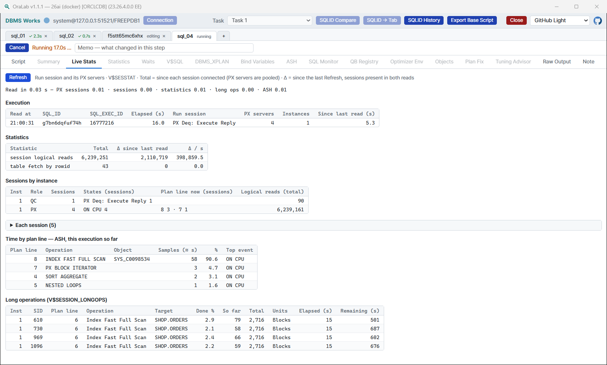
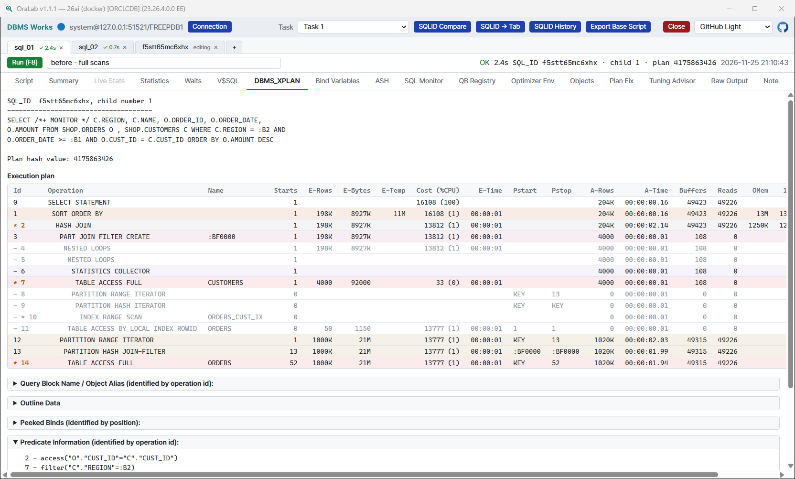
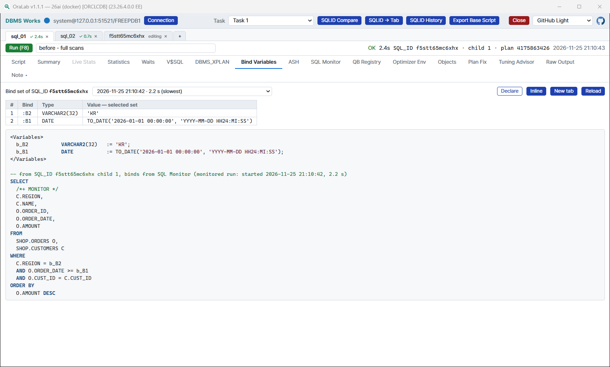
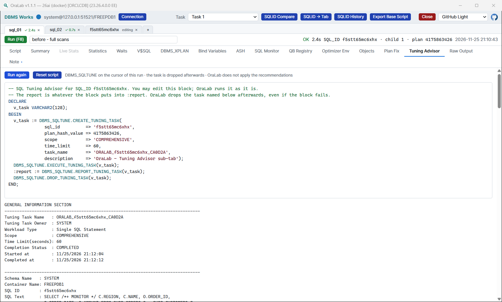

# OraLab — a workbench for tuning Oracle SQL (free)


**[Download the latest release](https://github.com/Doni-Kim/oralab-release/releases/latest)** ·
[한국어 설명](README.ko.md) · [User guide (English)](OraLab_manual_en.html) · [사용 설명서 (한국어)](OraLab_manual_kr.html)

OraLab is a desktop workbench for tuning one SQL statement at a time. Paste the statement, press F8, and get its session
statistics, wait events, V$SQL figures and the actual execution plan in one run. Change the SQL, run it again in the next
tab, and put the two runs side by side. One window, one executable, nothing to install on the server and no Oracle client
on your PC.

## Screenshots

| A tab with the SQL and its bind variables | Summary of a run |
|---|---|
|  |  |

| Live Stats — where a running SQL is spending its time | |
|---|---|
|  | |

| Session statistics (V$MYSTAT delta) | The plan it actually ran |
|---|---|
|  |  |

| Bind Variables — every set of bind values of the SQL_ID | SQL Monitor report of a parallel run |
|---|---|
|  |  |

| Objects — tables, indexes, predicate columns | Plan Fix — SQL Patch, baseline and SQL Profile script |
|---|---|
|  |  |

| Tuning Advisor — editable script and report | Compare — metrics per execution |
|---|---|
|  |  |

| Compare — two plans in one table | SQLID Compare — two SQL_IDs from the cursor cache or AWR |
|---|---|
|  |  |

| SQLID → Tab, with the captured binds | Tasks |
|---|---|
|  |  |

| SQLID History — the plans of a SQL_ID in AWR | SQLID History — the trend, line colour = plan |
|---|---|
|  |  |

The screenshots show test tables on a local test database.

## Install

- Unzip, keep the folder together, and run `OraLab.exe` (single-file publish).
- No .NET install and no Oracle client needed — both are inside the executable.
- There is no configuration file. Connections are entered in the start window and kept, with everything else, in
  `OraLab.db` next to the executable (passwords are stored encrypted).

## What it does

- **Runs the SQL to the end, and measures it on the server** — your statement is wrapped in a trace script that fetches
  every row and prints the session statistic deltas (V$MYSTAT, PX slaves included), the wait events, the V$SQL figures and
  `DBMS_XPLAN.DISPLAY_CURSOR` with actual row counts, times and buffers. OraLab shows each part as a sortable table.
  The run ends with a ROLLBACK.
- **Bind variables** — declare them in a `<Variables>` block at the top of the tab and the SQL uses them as real binds,
  so bind peeking and cursor sharing behave as in production.
- **Session commands** — a `<Commands>` block (`ALTER SESSION …`, anonymous PL/SQL blocks) before the SQL runs before the test SQL, one after
  the SQL runs after the measuring — in the same session, and they stay with the result.
- **Live Stats** (1.1.0+) — while a SQL of tens of seconds or minutes runs, each Refresh shows the state of the run session and
  its PX servers (also on other RAC instances), read statistics as total, change and per second, the progress of long operations and,
  with Diagnostics Pack, the plan line each session is on and the time spent per plan line so far. Sessions are grouped per instance,
  and a line at the top shows how long each query took.
- **Steps as tabs** — every change gets its own tab with a memo and a note; tabs are grouped into tasks. Scripts,
  notes and results are saved automatically.
- **Compare** — two tabs, or two SQL_IDs from the cursor cache or AWR: metrics per execution, both plans merged into one
  table with what went down and up, waits, and statistics. Save the comparison as Excel (with a chart), PDF or HTML.
- **SQLID → Tab** — brings a statement from the cursor cache (or AWR) into a tab together with bind values: those of its
  slowest SQL Monitor run, else the cursor cache capture, else AWR.
- **Bind Variables** — every set of bind values of a SQL_ID (SQL Monitor runs, cursor cache, AWR) in a list; open it in a new tab as
  declared variables or as literals.
- **SQLID History** — what AWR kept about one SQL_ID, in a separate window: its plans with per-execution figures (best and
  worst marked), bind values per snapshot, the trend with plan changes, ASH, past SQL Monitor reports, the optimizer
  environment and an AWR SQL report — and Excel, PDF or HTML of it all. Plan Fix loads a plan from AWR as a baseline (text only).
- **Objects** — the tables of the executed plan, all their indexes (the ones the plan used are marked) and the statistics
  of the predicate columns: NDV, histogram, low and high values, compression, In-Memory, partitions.
- **Plan Fix** — a ready-to-review script that pins the plan of a tab with a SQL Patch, a SQL Plan Baseline or a SQL Profile
  (the profile also covers statements that differ only in literals).
  OraLab shows it; it never runs it.
- **Tuning Advisor** — runs the SQL Tuning Advisor on the cursor of a tab and keeps its report with the tab (Tuning Pack).
- **Connection** — switch to another server without restarting; tasks and tabs stay. The dot before the address turns red
  when the server cannot be reached.
- **Exadata** — on Exadata the statistics add Smart Scan, Storage Index, HCC and Flash Cache items with a short assessment of each.
- **Sequence cache refills** (1.0.8+) — line 34 of the statistics shows the time the statement spent refilling sequence
  caches. It appears only when it adds up to 1 ms or more — a sign of a small cache or `NOCACHE`.
- **Also** — ASH by plan line (with the wait events of each line), SQL Monitor report, Query Block Registry, optimizer environment, plan line colours,
  Beautify (spaces and line breaks only), Excel, PDF and HTML of a single tab, 12 themes.

The bundled user guide has the details, with screenshots, in English and Korean.

## Diagnostics and Tuning Pack

Features that need a pack licence are **off by default**. Each connection has two boxes, and OraLab reads nothing from a
pack that is not ticked — querying those views alone leaves a trace in `DBA_FEATURE_USAGE_STATISTICS`.

- **Diagnostics Pack licensed**
  - Tab run: ASH by plan line
  - SQLID Compare: AWR and ASH waits
  - SQLID → Tab: AWR bind values
  - Live Stats: the plan line of each session and the time per plan line
  - SQLID History
- **Tuning Pack licensed**
  - Tab run: the SQL Monitor report
  - SQLID → Tab: SQL Monitor bind values
  - Plan Fix: the SQL Profile section
  - Tuning Advisor: the sub-tab
  - SQLID History: the SQL Monitor tab

Even when ticked, nothing is read if the server's `control_management_pack_access` excludes the pack. One exception:
a tab into which you paste the whole trace script is your own text and runs as written — switch the two parts off in
the script there (user guide, chapter 13).

## System requirements and limitations

- **OS**: Windows only (x64). The UI is web-based (Blazor Hybrid), so it does not run on Linux or macOS.
- **Database**: Oracle 12.2 or later. Checked on 12.2, 19c and 26ai.
- **One SELECT SQL per tab**: a tab holds the one SELECT SQL you tune. More than one SELECT SQL, DML, DDL, PL/SQL and SQL*Plus commands are not run.

## Required database privileges

With these grants every feature of OraLab works — checked on 12.2, 19c and 26ai with an account holding only these.
*Export Base Script* writes the same grants in the header of the script.

```sql
CREATE USER oralab IDENTIFIED BY "...";
GRANT CREATE SESSION TO oralab;
GRANT SELECT_CATALOG_ROLE TO oralab;
GRANT SELECT ANY DICTIONARY TO oralab;
GRANT SELECT ANY TABLE TO oralab;                          -- tables and views read by the SQL you tune
GRANT ADVISOR TO oralab;                                   -- Tuning Advisor sub-tab (Tuning Pack)
GRANT EXECUTE ON SYS.DBMS_WORKLOAD_REPOSITORY TO oralab;   -- AWR Report in SQLID History (Diagnostics Pack)

-- only if the SQL you tune uses objects of other schemas:
GRANT SELECT ANY SEQUENCE TO oralab;                       -- sequences
GRANT EXECUTE ANY PROCEDURE TO oralab;                     -- functions
```

**Note**: `DBMS_XPLAN`, `DBMS_SQLTUNE` and the other packages are executable by PUBLIC; `DBMS_WORKLOAD_REPOSITORY` is not.
The trace script is a single PL/SQL block: if any view it reads is not granted, the whole block fails to compile and nothing runs.

## WebView2 runtime requirement

OraLab draws its window with the Microsoft Edge WebView2 Runtime. When the runtime is missing, OraLab says so at startup and exits.
It is built into Windows 11 and shipped to most Windows 10 machines; Windows Server often needs it installed separately.

Use Microsoft's "Evergreen Standalone Installer" (`MicrosoftEdgeWebView2RuntimeInstallerX64.exe`) from the
[official WebView2 download page](https://developer.microsoft.com/microsoft-edge/webview2/).

The WebView2 cache is kept in a `WebView2` folder next to `OraLab.exe` (from 1.0.10 — before, `%LOCALAPPDATA%\OraLab.WebView2`, which you can delete). If the exe folder is not writable, the default location is used.

## Troubleshooting and issues

Errors are written to `OraLab.log` next to the executable (the file only appears when something went wrong).

- **Bugs and questions** — open an [issue](https://github.com/Doni-Kim/oralab-release/issues).
- **Security note** — please do not attach the log or `OraLab.db` there: the log holds no passwords, but both can contain server addresses and SQL text.
