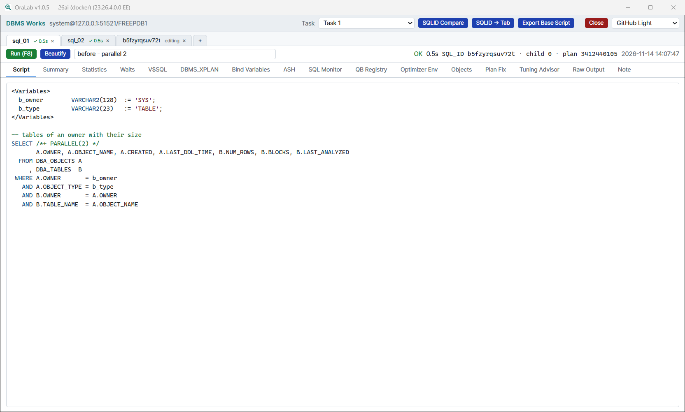
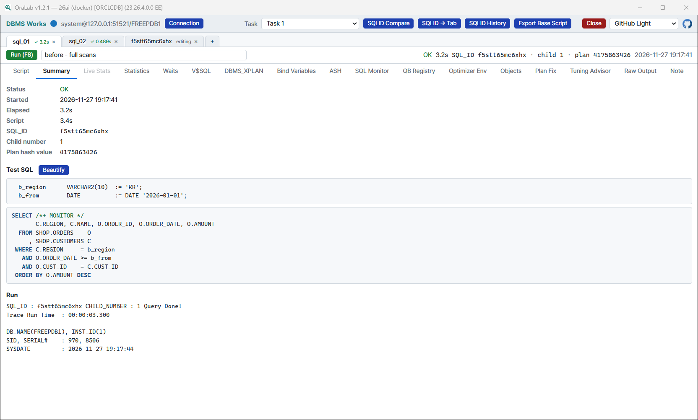
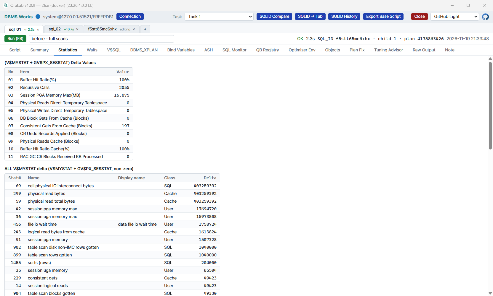
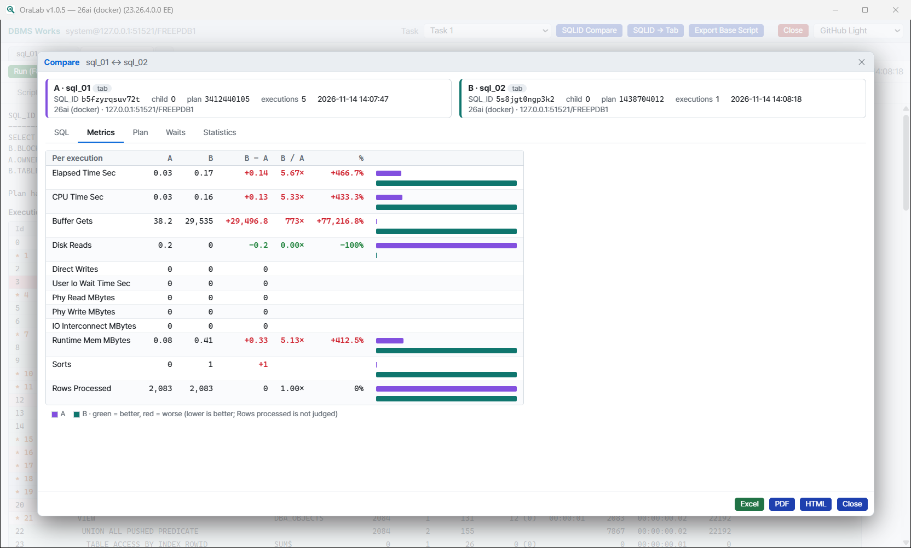
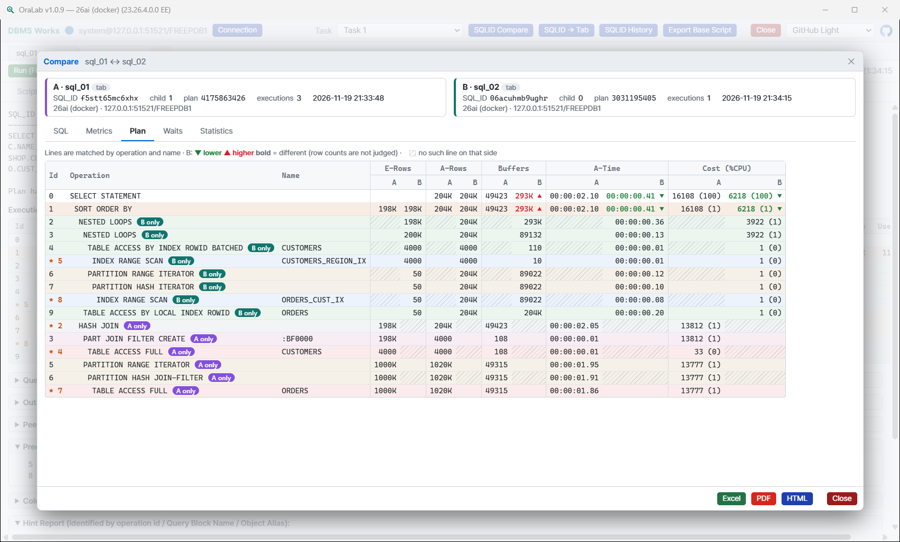
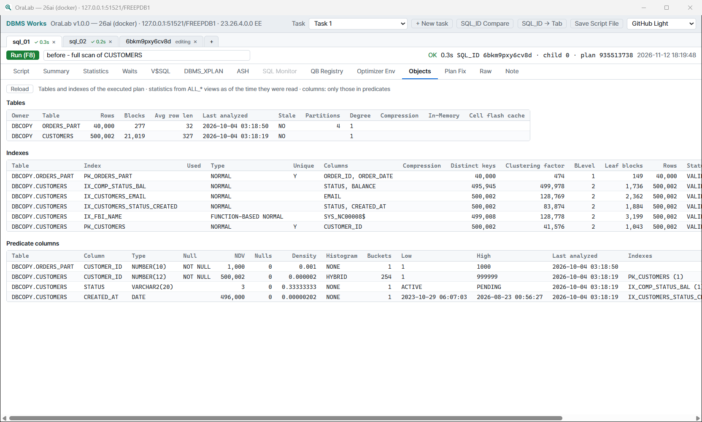
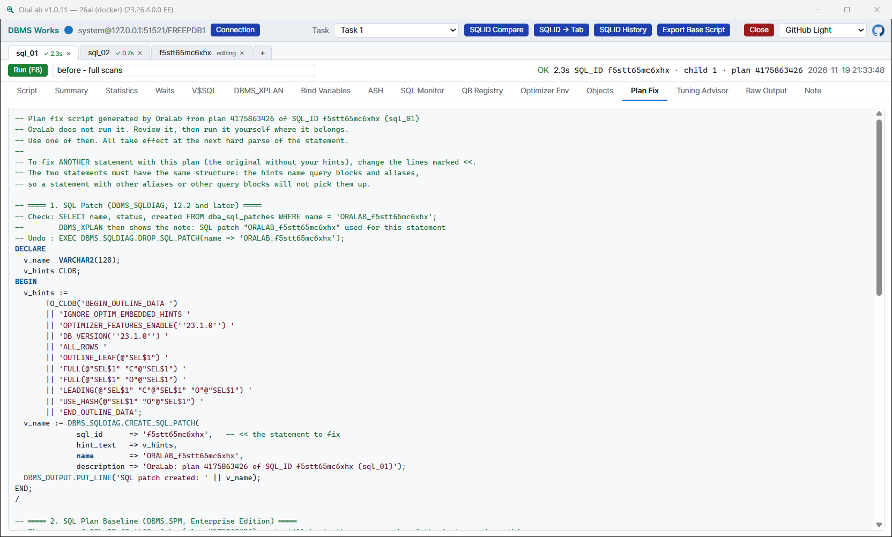
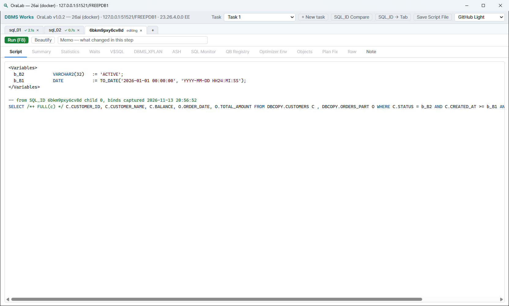
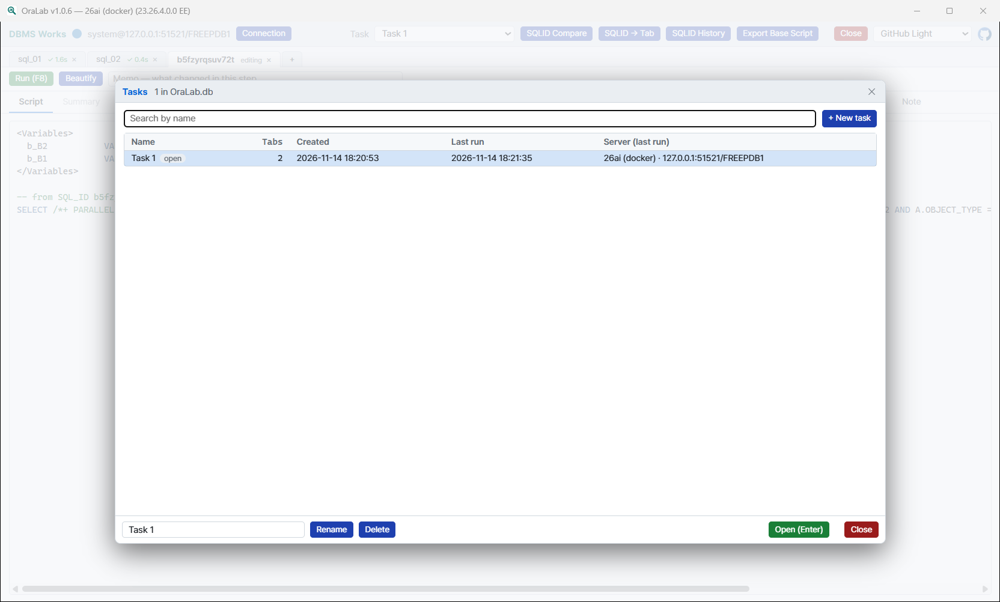

# OraLab — a workbench for tuning Oracle SQL (free)


**[Download the latest release](https://github.com/Doni-Kim/oralab-release/releases/latest)** ·
[한국어 설명](README.ko.md) · [User guide (English)](OraLab_manual_en.html) · [사용 설명서 (한국어)](OraLab_manual_kr.html)

OraLab is a desktop workbench for tuning one SQL statement at a time. Paste the statement, press F8, and get its session
statistics, wait events, V$SQL figures and the actual execution plan in one run. Change the SQL, run it again in the next
tab, and put the two runs side by side. One window, one executable, nothing to install on the server and no Oracle client
on your PC.

## Screenshots

| A tab with the SQL and its bind variables | The plan it actually ran |
|---|---|
|  |  |

| Summary of a run | Session statistics (V$MYSTAT delta) |
|---|---|
|  |  |

| Compare — metrics per execution | Compare — two plans in one table |
|---|---|
|  |  |

| Objects — tables, indexes, predicate columns | Plan Fix — SQL Patch and baseline script |
|---|---|
|  |  |

| SQL_ID → Tab, with the captured binds | Tasks |
|---|---|
|  |  |

The screenshots show test tables on a local test database.

## Install

- Unzip, keep the folder together, and run `OraLab.exe` (single-file publish).
- No .NET install and no Oracle client needed — both are inside the executable.
- There is no configuration file. Connections are entered in the start window and kept, with everything else, in
  `OraLab.db` next to the executable (passwords are stored encrypted).

## What it does

- **Runs the SQL to the end, and measures it on the server** — your statement is wrapped in a trace script that fetches
  every row and prints the session statistic deltas (V$MYSTAT, PX slaves included), the wait events, the V$SQL figures and
  `DBMS_XPLAN.DISPLAY_CURSOR` with actual row counts, times and buffers. OraLab shows each part as a sortable table.
  The run ends with a ROLLBACK.
- **Bind variables** — declare them in a `<Variables>` block at the top of the tab and the SQL uses them as real binds,
  so bind peeking and cursor sharing behave as in production.
- **Session commands** — a `<Commands>` block (`ALTER SESSION …`, PL/SQL blocks) runs before the test SQL in the same session,
  and stays with the result.
- **Steps as tabs** — every change gets its own tab with a memo and a note; tabs are grouped into tasks. Scripts,
  notes and results are saved automatically.
- **Compare** — two tabs, or two SQL_IDs from the cursor cache or AWR: metrics per execution, both plans merged into one
  table with what went down and up, waits, and statistics. Save the comparison as Excel (with a chart), PDF or HTML.
- **SQL_ID → Tab** — brings a statement from the cursor cache into a tab together with its captured bind values.
- **Objects** — the tables of the executed plan, all their indexes (the ones the plan used are marked) and the statistics
  of the predicate columns: NDV, histogram, low and high values, compression, In-Memory, partitions.
- **Plan Fix** — a ready-to-review script that pins the plan of a tab with a SQL Patch or a SQL Plan Baseline.
  OraLab shows it; it never runs it.
- **Also** — ASH by plan line, SQL Monitor report, Query Block Registry, optimizer environment, plan line colours,
  Beautify (spaces and line breaks only), whole SQL*Plus-style scripts, Excel, PDF and HTML of a single tab, 12 themes.
- On **Exadata** the statistics add Smart Scan, Storage Index, HCC and Flash Cache items with a short assessment of each.

The bundled user guide has the details, with screenshots, in English and Korean.

## Diagnostics and Tuning Pack

Features that need a pack licence are **off by default**. Each connection has two boxes, and OraLab reads nothing from a
pack that is not ticked — querying those views alone leaves a trace in `DBA_FEATURE_USAGE_STATISTICS`.

- **Diagnostics Pack licensed** — ASH by plan line in a tab run; AWR and ASH waits in SQL_ID Compare.
- **Tuning Pack licensed** — the SQL Monitor report of a tab run.

Even when ticked, nothing is read if the server's `control_management_pack_access` excludes the pack. One exception:
a tab into which you paste the whole trace script is your own text and runs as written — switch the two parts off in
the script there (user guide, chapter 12).

## Requirements and limits

- **Windows only** (x64). The UI is web-based (Blazor Hybrid), so it does not run on Linux or macOS.
- **Oracle 12.2 or later.** Checked on 12.2, 19c and 26ai.
- A tab that holds a single statement accepts SELECT and WITH only; DML, DDL and PL/SQL run as a script.
- The code is obfuscated with ConfuserEx — a free tool, so do not expect strong protection.

## Privileges

The account you connect with needs to read the performance views the trace script uses.

```sql
CREATE USER oralab IDENTIFIED BY "...";
GRANT CREATE SESSION TO oralab;
GRANT SELECT_CATALOG_ROLE TO oralab;                 -- V$ and GV$ views
GRANT EXECUTE ON SYS.DBMS_SQLTUNE TO oralab;         -- optional, Tuning Pack only: SQL Monitor report
```

Plus whatever the SQL you are tuning needs to read. *Save Script File* writes the trace script to disk; its header lists
the grants view by view if you prefer not to use the role. A part without the privilege prints Oracle's error in its
place and the rest still appears.

## WebView2 Runtime

OraLab draws its window with the Microsoft Edge WebView2 Runtime. When the runtime is missing, OraLab says so at startup and exits.
It is built into Windows 11 and shipped to most Windows 10 machines; Windows Server often needs it installed separately —
use Microsoft's "Evergreen Standalone Installer" (`MicrosoftEdgeWebView2RuntimeInstallerX64.exe`) from
https://developer.microsoft.com/microsoft-edge/webview2/

## If something breaks

Errors are written to `OraLab.log` next to the executable (the file only appears when something went wrong).

- **Bugs and questions** — open an [issue](https://github.com/Doni-Kim/oralab-release/issues).
  Please do not attach the log or `OraLab.db` there: the log holds no passwords, but both can contain server addresses and SQL text.
